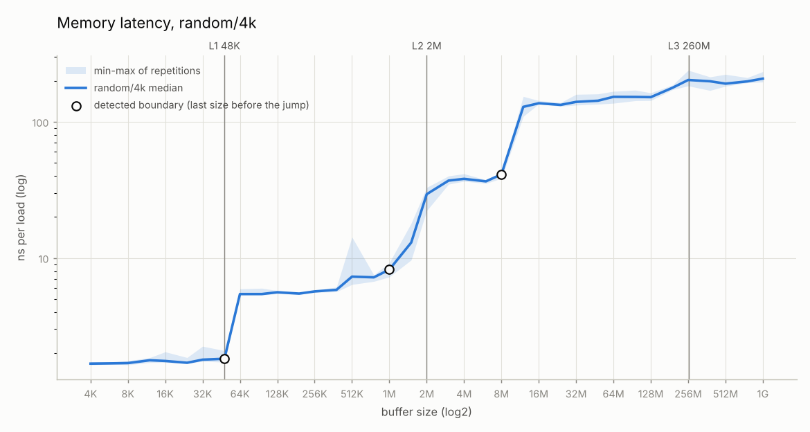
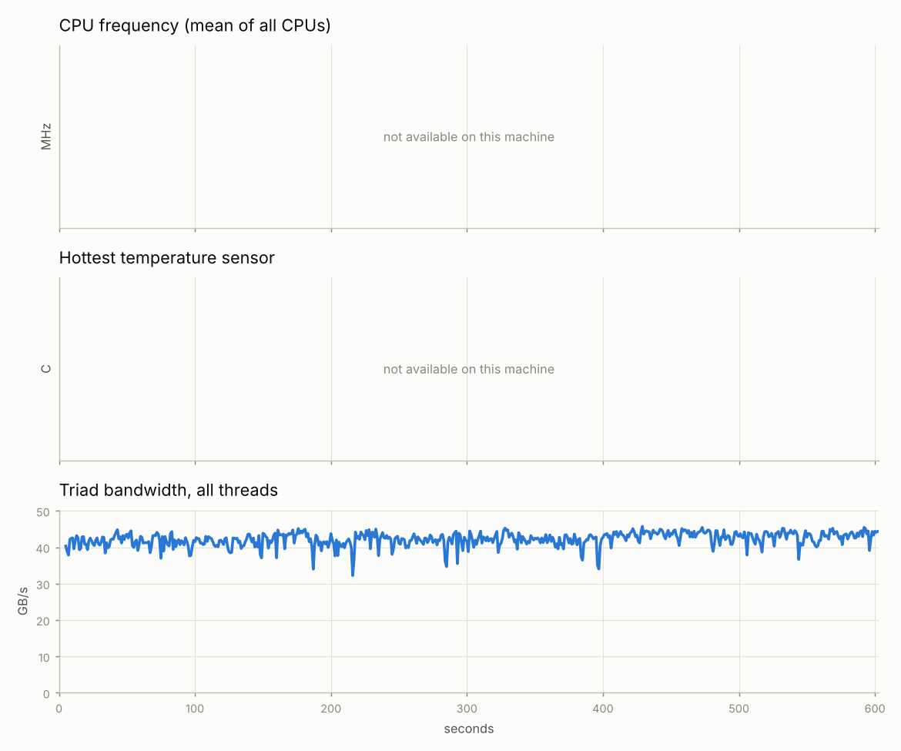

# hwdiag

[](https://github.com/kamboj-sajan/linux_test/actions/workflows/ci.yml)

Linux hardware diagnostics in C++ and Python. Four command-line tools read the machine's hardware
description and measure its memory system. A Python harness runs them as suites, plots the
results, compares runs for regressions and stress-tests the machine while watching for thermal
throttling.

| Tool | What it does |
|---|---|
| `inventory` | CPU, topology, caches, frequency, memory, NUMA, PCIe links, sensors and EDAC counts from `/proc` and `/sys`, with health checks |
| `memlat` | load-to-use latency from L1 to DRAM by chasing a random cycle of cache lines, with 4 KiB vs huge pages and random vs sequential access |
| `membw` | STREAM copy/scale/add/triad bandwidth from 1 to N pinned threads |
| `memtest` | eight test patterns over a locked buffer, with fault injection to prove each pattern catches a flipped bit |
| `perfctr` | a `perf_event_open` library for hardware counters (cycles, instructions, cache, branch, L1D and dTLB misses), used by memlat and membw |
| `hwdiag` | the Python harness: `inventory`, `run`, `report`, `compare`, `stress` |

Every tool writes the same JSON format, checked by a JSON Schema. [docs/METHOD.md](docs/METHOD.md)
explains how each measurement works and where it stops being trustworthy.

## Results: cloud VM

> **These numbers come from a cloud VM, not a bare-metal machine.** It is the KVM guest this
> project was developed in: an `Intel(R) Xeon(R) Processor @ 2.10GHz` (as the guest reports it),
> 4 vCPUs, 15.7 GiB RAM, kernel 6.18, GCC 13.3 at `-O2`. The VM exposes no CPU PMU, no cpufreq, no
> hwmon sensors, no PCIe link status and no EDAC, so this run exercises every fallback path. It
> doesn't show hardware counters, frequency or temperature. Full suite (`hwdiag run --suite full`)
> plus a 10-minute `hwdiag stress`, files in [results/cloud-vm/](results/cloud-vm/), report in
> [results/cloud-vm/REPORT.md](results/cloud-vm/REPORT.md).

| Measure | Value | Source |
|---|---|---|
| L1d latency (16 KiB, random, 4 KiB pages) | 1.75 ns | [memlat.json](results/cloud-vm/memlat.json) |
| L2 latency (1 MiB) | 8.21 ns | memlat.json |
| Effective L3 latency (8 MiB) | 41.1 ns | memlat.json |
| **DRAM latency (1 GiB, random, 4 KiB pages)** | **207.2 ns** | memlat.json `dram_latency_ns` |
| DRAM latency, 2 MiB huge pages (1 GiB) | 149.3 ns | memlat.json, `random/huge` |
| Sequential walk (1 GiB, prefetchers on) | 8.82 ns | memlat.json, `sequential/4k` |
| Detected cache sizes vs sysfs | 48K vs L1d 48K; 1.5M vs L2 2M; 8M vs L3 260M | memlat.json `detected_caches` |
| Triad bandwidth, 1 thread / 4 threads (best) | 12.0 / 43.4 GB/s | [membw.json](results/cloud-vm/membw.json) |
| memtest | 3.76 GiB locked, 8 patterns, 0 errors, 204 s | [memtest.json](results/cloud-vm/memtest.json) |
| 10-minute stress, triad on 4 threads | mean 42.3 GB/s, range 32.2–45.8; no frequency or temperature data | [stress.json](results/cloud-vm/stress/stress.json) |
| Hardware counters | unavailable: `perf_event_open` fails with ENOENT (no PMU in the VM) | [perfcheck.json](results/cloud-vm/perfcheck.json) |



What the curve shows:

- **L1 and L2 match sysfs.** The first step lands exactly at the 48 KiB L1d. The second comes at
  1.5 MiB, below the 2 MiB L2, as expected once associativity and random page placement are
  counted.
- **The L3 is far smaller than sysfs says.** sysfs reports the host's 260 MiB L3, but this guest
  only gets a share of it: latency leaves the ~40 ns plateau after 8 MiB and is at DRAM level
  (≈ 125–137 ns) by 16 MiB.
- **Past 16 MiB, the 4 KiB curve keeps rising** (≈ 140 ns at 32 MiB, 207 ns at 1 GiB) while the
  huge-page curve stays around 125–155 ns. The gap (58 ns at 1 GiB) is consistent with page walks:
  with 4 KiB pages the TLB covers only a few MiB, while 2 MiB pages cover the whole buffer. The
  dTLB-miss counter would confirm it on hardware with a PMU.


A sequential walk over the same 1 GiB costs 8.8 ns per load instead of 207 ns. The prefetchers see
the pattern and fetch ahead, which is why latency has to be measured with a random cycle.


Bandwidth scales almost linearly to the 4 vCPUs (12.0 → 43.4 GB/s triad, 90% of 4× one thread),
so 4 vCPUs don't reach the memory system's limit. Copy and scale sit below add and triad, as
write-allocate predicts (see [What the numbers mean](#what-the-numbers-mean)). If the real traffic
is the same, the reported copy/triad ratio should be (16/24)/(24/32) = 0.89. With one thread it is
10.5/12.0 = 0.875.



The VM has no cpufreq or hwmon, so the stress test can only show bandwidth over time. It reports
that frequency-based throttling detection was skipped rather than claiming "no throttling".

### Still to run on real hardware

| Needs | What it shows | Why not here |
|---|---|---|
| CPU PMU (`perf_event_paranoid ≤ 2`) | per-size IPC, cycles, L1D and dTLB misses per load; counters in membw | the VM has no PMU (ENOENT) |
| `perf` installed + PMU | perfctr vs `perf stat` cross-check (target: within 5%) | same |
| cpufreq + hwmon | frequency and temperature over time; throttling detection; temperature check | not exposed in the VM |
| PCIe devices with link status | link speed/width check | virtual devices have no link attributes |
| ECC memory with EDAC | memory error counts | not present |
| 2+ NUMA nodes | local vs remote latency | one node |

## Quick start

You need real Linux: a bare-metal Ubuntu 24.04 install or a dual boot. macOS has no
`perf_event_open`, and WSL2 and most cloud VMs hide the CPU's hardware counters. Everything else
still runs there, and the counter fields record why they are empty.

```sh
# Let normal users read hardware counters (Ubuntu blocks it by default)
sudo sysctl kernel.perf_event_paranoid=1
# Build tools, plus perf, lm-sensors and pciutils for cross-checking the numbers
sudo apt install build-essential cmake ninja-build libgtest-dev python3-venv \
                 linux-tools-generic lm-sensors pciutils
# memtest locks its buffer in RAM
ulimit -l unlimited

git clone https://github.com/kamboj-sajan/linux_test.git hwdiag && cd hwdiag
cmake -S . -B build -G Ninja && cmake --build build
ctest --test-dir build                       # GoogleTest

python3 -m venv .venv && . .venv/bin/activate
pip install -e '.[dev]'
pytest                                       # pytest

hwdiag inventory                             # what is this machine, and is anything wrong?
hwdiag run --suite full                      # 5-15 min (memtest scales with RAM); writes results/<host>-<time>/
hwdiag report results/<host>-<time>          # plots + REPORT.md in the run directory
```

GoogleTest comes from the `libgtest-dev` package; without it CMake downloads v1.14.0. Cross-check
the numbers with `perf stat`, `lscpu`, `lspci -vv` and `sensors`.

## Commands

```sh
hwdiag inventory [--temp-threshold 85] [--json]
hwdiag run --suite quick|full [--out DIR]
hwdiag report <run-dir> [--out DIR]
hwdiag compare <base> <new> --tolerance 5 [--json]
hwdiag stress --minutes 10 [--interval 1]
```

- **inventory** prints the hardware summary and the checks. A PCIe link slower or narrower than
  its maximum is a warning (re-check under load: GPUs slow their links at idle), a sensor above the
  threshold is a warning, and any EDAC memory error is a failure (exit 2).
- **run** runs inventory, memlat, membw, memtest and perfcheck into one directory with a `run.json`
  manifest. `quick` takes about a minute and is what CI runs. `full` measures up to 1 GiB, tests
  25% of available RAM and, on multi-socket machines, adds a local vs remote NUMA latency run.
  When `perf` is installed, perfcheck runs under `perf stat` and the two sets of counts are
  compared.
- **report** draws the latency curve (log2 x-axis, sysfs cache sizes as vertical lines, detected
  boundaries marked), the pattern and page-size comparison, and bandwidth vs threads. It writes
  `REPORT.md` with a table for every chart, the counter results and any inventory warnings.
- **compare** prints the % change of each metric (L1/L2/L3/DRAM latency per curve, best GB/s per
  kernel and thread count, memtest errors) and exits 1 if anything got worse than the tolerance,
  so CI can gate on it.
- **stress** runs membw on every core and records CPU frequency, temperature, utilisation and
  bandwidth every second, then plots them over time. Frequency falling while the load stays the
  same is flagged as thermal throttling (exit 2).

The C++ tools also run on their own; each has `--help`:

```sh
build/bin/memlat --min 4K --max 1G --modes all --out memlat.json
build/bin/membw --threads 1,2,4 --reps 10
build/bin/memtest --size 1G --inject-fault 4096:5      # every pattern must report the flipped bit
build/bin/inventory --root tests/fixtures/sys/server   # read a fake /sys tree
```

Exit codes everywhere: 0 ok, 1 error, 2 ran fine but found a problem.

## Architecture

```
 C++ tools (CMake)                         Python harness (hwdiag)
 ┌───────────┐                             ┌──────────────────────────────┐
 │ inventory │──┐                          │ run      → runs suites       │
 │ memlat    │──┤                          │ report   → plots + Markdown  │
 │ membw     │──┼── JSON results ─────────▶│ compare  → regression check  │
 │ memtest   │──┤   (one shared format)    │ stress   → temp/freq vs time │
 └─────┬─────┘  │                          └──────────────────────────────┘
       └── perfctr (perf_event_open wrapper, used by memlat/membw)
```

```
src/        common/ (json, timing, affinity, host info, args), inventory/, memlat/, membw/,
            memtest/, perfctr/ (library + perfcheck)
tests/      cpp/ (GoogleTest), python/ (pytest), fixtures/sys/ (fake sysfs trees),
            fixtures/results/ (a real quick-suite run)
harness/    hwdiag/ (cli, run, report, compare, stress, inventory, schema.json)
results/    sample runs
docs/       plots/, METHOD.md
```

Every result has the same envelope: `format_version`, `tool`, `tool_version`, `timestamp`,
`git_commit`, `host` (hostname, kernel, CPU model, logical CPUs, frequency governor, turbo, SMT,
compiler and compiler flags), `params`, `results` and `warnings`. The schema is
[harness/hwdiag/schema.json](harness/hwdiag/schema.json).

## Measurement rules

- Pin threads to cores, do a warm-up run, repeat each measurement, and report the median plus the
  spread. memlat pins to one core and repeats every size 5–7 times. membw pins every worker, one
  per physical core before any SMT sibling.
- Touch every page of a buffer before timing it, so first-access page faults don't count.
- Record the frequency governor, turbo state, kernel version and compiler flags in every result.
  For stable numbers set the governor to `performance`
  (`sudo cpupower frequency-set -g performance`).
- Close other programs, and note whether Hyper-Threading is on (recorded as `smt`).

## What the numbers mean

**Copy moves more bytes than it counts.** STREAM credits copy with 16 bytes per element (read `a`,
write `c`). But a normal store to a line that isn't cached first reads that line from memory
(write-allocate), so copy really moves 24 bytes per element. Scale is the same, and add and triad
move 32 bytes for the 24 they report. The kernels are compiled so the copy loop stays a loop and
doesn't turn into a `memcpy` that could use non-temporal stores and skip that read.

**What the memory test can and can't show:**

- A user-space test only checks memory the kernel hands it; the kernel, other programs and the
  page cache are never tested.
- Caches can hide faults: a value read back while still cached never went to DRAM. The buffer is
  made much larger than the caches so most reads come from DRAM.
- ECC memory corrects single-bit errors before the test sees them; check the EDAC counts with
  `hwdiag inventory` afterwards.
- It demonstrates the method. It doesn't replace memtest86+, which runs before the OS and covers
  almost all of physical memory.

## Testing

- **GoogleTest** (`ctest --test-dir build`):
  - Sattolo always produces one cycle, and the chain visits every line.
  - Boundary detection and cache matching.
  - Every memtest pattern catches an injected fault with the right offset, expected value and XOR
    mask, and finds nothing without one.
  - The inventory parsers read the fake desktop and server sysfs trees.
  - perfctr's "unavailable" handling for every errno, plus group splitting, multiplexing and
    scaling, through a fake kernel.
  - The STREAM kernels and validation, JSON escaping and statistics.
- **pytest** (`pytest`):
  - The schema accepts real results and rejects broken ones.
  - `run` against a directory of fake tools.
  - `compare` and its exit codes, and `report` from a real run.
  - Throttling detection on made-up series, and the stress samplers on a fake sysfs.
- **CI** ([.github/workflows/ci.yml](.github/workflows/ci.yml)): release (gcc), sanitizer
  (`-fsanitize=address,undefined`) and clang builds. Each runs both test suites and ruff, then
  `hwdiag run --suite quick`, `hwdiag report` and `hwdiag compare`. GitHub's runners don't allow
  hardware counters (`perf_event_open` fails with `EACCES`), so CI proves the fallback path.
- Compiler settings: `-O2 -Wall -Wextra -Werror` on gcc 13 and clang 18.
- Count: 101 GoogleTest cases and 75 pytest cases (176 in total), all passing in the release,
  sanitizer and clang builds.

## Limitations

- In a VM the L3 is shared with other tenants. Its effective size is far below what sysfs reports,
  and every number moves with the neighbours' load.
- Hybrid Intel CPUs (P-cores and E-cores) have two PMUs; pin counted work to a P-core.
- The NUMA run needs more than one node, so here it has only been tested with fakes.
- memtest has no retention delays and no row-hammer patterns.
