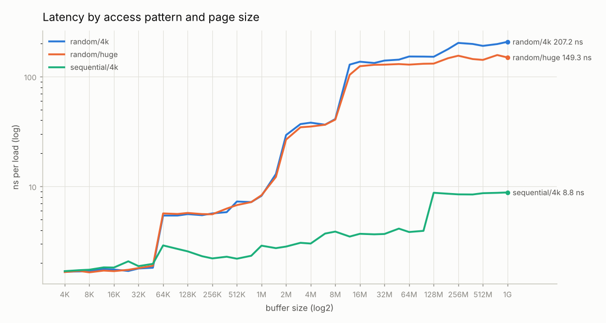
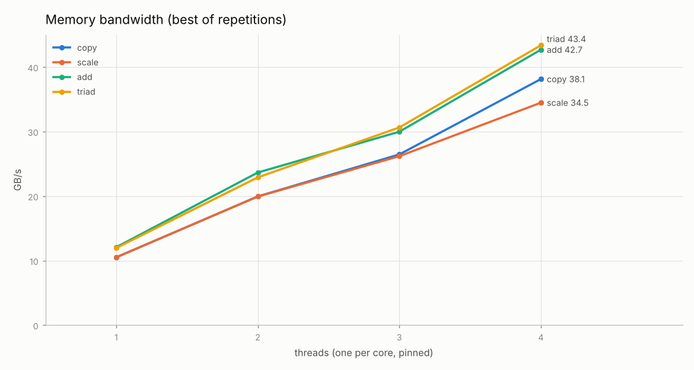

# hwdiag report: vm

Suite: full · run directory: `results/cloud-vm`

- **CPU:** Intel(R) Xeon(R) Processor @ 2.10GHz (4 logical CPUs)
- **Kernel:** 6.18.44-fc-v114 · **governor:** n/a (no cpufreq) · **turbo:** unknown · **SMT:** off
- **Compiler:** GCC 13.3.0 `-std=c++20 -O2 -DNDEBUG -Wall -Wextra -Werror` (Release)
- **Commit:** `0d92d7db85eb` · **measured:** 2026-10-14T11:59:38Z

## Summary

| measure | value | source |
|---|---|---|
| DRAM latency (random, 4 KiB pages) | 207.2 ns at 1G | memlat.json |
| Peak bandwidth | 43.4 GB/s (triad, 4 threads) | membw.json |
| memtest errors | 0 in 3.8G | memtest.json |
| Hardware counters | unavailable | memlat.json |
| Inventory status | ok | inventory.json |

## Inventory

| item | value |
|---|---|
| CPU | Intel(R) Xeon(R) Processor @ 2.10GHz |
| Topology | 1 socket(s), 4 core(s), 4 thread(s) |
| Caches | L1d 48K, L1i 32K, L2 2M, L3 260M (line 64 B) |
| Memory | 15.7G, 1 NUMA node(s) |
| PCIe devices | 11 (0 with link status) |
| Sensors | 0 |
| EDAC | not present |
| Status | ok |

**Checks**

- `info` **pcie_link** all: no PCIe devices report link speed and width (normal in VMs)
- `info` **temperature** hwmon: no temperature sensors found (normal in VMs)
- `info` **edac** edac: EDAC not present (normal on desktops and VMs); memory error counts can't be read
- No inventory warnings.

## Memory latency (memlat)

Pointer chasing over a random cycle of 64-byte lines (Sattolo's algorithm), one pinned core, median of 7 repetitions. Vertical lines: cache sizes from sysfs. Circles: detected boundaries (the last size before latency rose more than 1.5x).

Latency table: median ns per load (spread)

| size | random/4k | random/huge | sequential/4k |
|---|---|---|---|
| 4K | 1.67 (5%) | 1.66 (5%) | 1.69 (4%) |
| 6K | 1.68 (3%) | 1.70 (6%) | 1.73 (7%) |
| 8K | 1.69 (7%) | 1.65 (6%) | 1.75 (26%) |
| 12K | 1.77 (8%) | 1.71 (20%) | 1.83 (7%) |
| 16K | 1.75 (19%) | 1.69 (7%) | 1.83 (8%) |
| 24K | 1.70 (10%) | 1.74 (6%) | 2.08 (21%) |
| 32K | 1.79 (28%) | 1.81 (56%) | 1.88 (26%) |
| 48K | 1.82 (20%) | 1.89 (59%) | 1.97 (21%) |
| 64K | 5.43 (11%) | 5.68 (6%) | 2.90 (34%) |
| 96K | 5.43 (12%) | 5.61 (10%) | 2.70 (7%) |
| 128K | 5.60 (5%) | 5.74 (11%) | 2.56 (18%) |
| 192K | 5.47 (4%) | 5.60 (6%) | 2.32 (12%) |
| 256K | 5.68 (4%) | 5.58 (7%) | 2.21 (10%) |
| 384K | 5.83 (8%) | 6.28 (23%) | 2.29 (10%) |
| 512K | 7.29 (108%) | 6.77 (13%) | 2.20 (10%) |
| 768K | 7.20 (11%) | 7.21 (85%) | 2.34 (30%) |
| 1M | 8.21 (24%) | 8.32 (21%) | 2.89 (20%) |
| 1.5M | 12.96 (64%) | 12.19 (50%) | 2.74 (14%) |
| 2M | 29.37 (36%) | 26.70 (42%) | 2.84 (14%) |
| 3M | 36.96 (14%) | 34.57 (12%) | 3.07 (9%) |
| 4M | 38.07 (13%) | 35.09 (6%) | 3.02 (4%) |
| 6M | 36.49 (6%) | 36.45 (2%) | 3.72 (18%) |
| 8M | 41.08 (8%) | 40.58 (14%) | 3.88 (19%) |
| 12M | 128.58 (34%) | 103.79 (31%) | 3.50 (13%) |
| 16M | 136.63 (6%) | 124.30 (14%) | 3.70 (11%) |
| 24M | 132.94 (6%) | 128.05 (10%) | 3.66 (13%) |
| 32M | 139.89 (19%) | 128.44 (8%) | 3.69 (14%) |
| 48M | 142.66 (18%) | 130.02 (8%) | 4.13 (6%) |
| 64M | 152.36 (20%) | 128.52 (5%) | 3.85 (17%) |
| 96M | 152.06 (18%) | 130.86 (5%) | 3.94 (53%) |
| 128M | 151.53 (13%) | 131.32 (7%) | 8.76 (13%) |
| 192M | 177.78 (8%) | 147.01 (8%) | 8.58 (15%) |
| 256M | 202.54 (27%) | 154.91 (16%) | 8.47 (6%) |
| 384M | 198.16 (22%) | 144.44 (15%) | 8.45 (11%) |
| 512M | 190.40 (21%) | 141.89 (15%) | 8.68 (8%) |
| 768M | 197.82 (9%) | 157.07 (12%) | 8.74 (17%) |
| 1G | 207.23 (18%) | 149.32 (11%) | 8.82 (11%) |

**Representative latencies** (point at half of each sysfs cache size; DRAM = largest size)

| curve | L1 | L2 | L3 | DRAM |
|---|---|---|---|---|
| random/4k | 1.70 ns @ 24K | 8.21 ns @ 1M | 151.53 ns @ 128M | 207.23 ns @ 1G |
| random/huge | 1.74 ns @ 24K | 8.32 ns @ 1M | 131.32 ns @ 128M | 149.32 ns @ 1G |
| sequential/4k | 2.08 ns @ 24K | 2.89 ns @ 1M | 8.76 ns @ 128M | 8.82 ns @ 1G |

**Detected cache boundaries** (from random/huge)

| detected | matched level | sysfs size | detected / sysfs |
|---|---|---|---|
| 48K | L1 | 48K | 1.00 |
| 1.5M | L2 | 2M | 0.75 |
| 8M | L3 | 260M | 0.03 |

## Memory bandwidth (membw)

STREAM kernels on 3 arrays of 1.0G (last-level cache 260M), 10 repetitions. GB/s counts bytes the STREAM way; copy also reads each destination line before writing it (write-allocate), which is not counted. Validated against the STREAM recurrence: **yes**.

| threads | copy | scale | add | triad |
|---|---|---|---|---|
| 1 | 10.5 / 9.6 | 10.5 / 9.8 | 12.1 / 11.4 | 12.0 / 11.1 |
| 2 | 19.9 / 17.8 | 19.9 / 16.9 | 23.7 / 20.4 | 22.9 / 20.6 |
| 3 | 26.5 / 24.5 | 26.2 / 25.0 | 30.0 / 29.6 | 30.6 / 29.1 |
| 4 | 38.1 / 32.4 | 34.5 / 32.7 | 42.7 / 38.4 | 43.4 / 37.9 |

Cells: best / median GB/s.

## Hardware counters (perfctr)

Hardware counters were unavailable: perf_event_open failed: ENOENT: event not supported here (VMs often expose no CPU PMU)

**Cross-check against perf stat** (perfcheck workload, same process)

Not compared: perfctr counters unavailable: perf_event_open failed: ENOENT: event not supported here (VMs often expose no CPU PMU)

## Memory test (memtest)

3.8G tested, locked with mlock, 0 error(s). Status: **pass**.

| pattern | pass | errors | seconds | GB/s |
|---|---|---|---|---|
| zeros | 1 | 0 | 1.38 | 5.9 |
| ones | 1 | 0 | 1.37 | 5.9 |
| checkerboard | 1 | 0 | 3.01 | 5.4 |
| walking_ones | 1 | 0 | 93.63 | 5.5 |
| walking_zeros | 1 | 0 | 93.71 | 5.5 |
| address_in_address | 1 | 0 | 2.80 | 5.8 |
| moving_inversions | 1 | 0 | 4.58 | 8.8 |
| random | 1 | 0 | 3.56 | 4.5 |

## Warnings

- hardware counters unavailable: perf_event_open failed: ENOENT: event not supported here (VMs often expose no CPU PMU)
